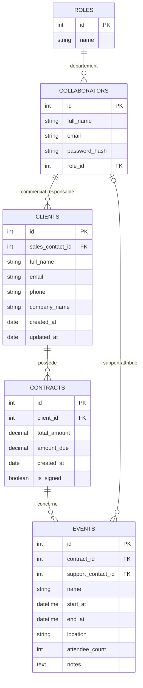

# Epic Events CRM

Projet de CRM en ligne de commande, développé étape par étape en Python.

## Étape 1 : environnement Python et base de données

SQLite est utilisé pour la première version. La base est un fichier local créé
automatiquement lors de la première connexion. SQLAlchemy fournit la connexion
qui servira aux modèles ORM des prochaines étapes.

Depuis le dossier du projet, avec Python 3.9 ou plus récent :

```powershell
python -m venv .venv
.\.venv\Scripts\python.exe -m pip install -r requirements.txt
Copy-Item .env.example .env
.\.venv\Scripts\python.exe database.py
```

Le dernier appel doit afficher `Connexion à la base de données réussie.` et
créer `epic_events.db`. Le fichier `.env` contient l'URL de connexion et n'est
pas versionné. Le fichier de base de données n'est pas versionné non plus.
Lancez les commandes depuis le dossier du projet, car le chemin SQLite dans
`.env` est relatif à ce dossier.

SQLite ne possède pas de comptes utilisateurs SQL ni de serveur à administrer.
Les droits d'accès au fichier sont ceux du compte Windows qui lance
l'application : utilisez un compte standard, sans droits administrateur, et
conservez la base dans un emplacement accessible uniquement à ce compte.
Les rôles et restrictions d'accès aux données du CRM seront implémentés dans
les étapes de développement.

## Étape 2 : modèles et tables

Après avoir configuré `.env`, créez les tables avec :

```powershell
.\.venv\Scripts\python.exe init_db.py
```

La commande peut être relancée : elle conserve les tables déjà présentes.



Le commercial d'un contrat est celui de son client. Les coordonnées du client
d'un événement sont accessibles par son contrat. Un événement peut attendre
l'attribution d'un support. Les règles propres aux rôles et la condition
« contrat signé avant création d'un événement » sont définies dans
`permissions.py`. Les opérations CRUD devront appeler ces contrôles.

## Étape 3 : comptes et permissions

Chaque collaborateur possède un numéro d'employé (`Collaborator.id`), un nom,
une adresse email unique et un département lié à la table `roles`.
`init_db.py` initialise les départements gestion, commercial et support.

Installez les dépendances, initialisez la base, puis créez votre premier compte :

```powershell
.\.venv\Scripts\python.exe -m pip install -r requirements.txt
.\.venv\Scripts\python.exe init_db.py
.\.venv\Scripts\python.exe create_first_manager.py
```

L'outil demande un nom, une adresse email et un mot de passe confirmé, masqué
pendant la saisie. Il crée un compte de gestion uniquement si aucun compte
n'existe. La base locale vide de l'étape 2 a été adaptée au nouveau schéma ;
une copie a été conservée dans `epic_events_step2_backup.db`, ignorée par Git.
Pour une autre base contenant l'ancien schéma, `init_db.py` signale qu'une
migration est nécessaire, car `create_all` ne modifie pas les tables existantes.

Les mots de passe doivent comporter de 12 à 128 caractères et ne peuvent pas
être composés uniquement d'espaces. Argon2id génère un sel aléatoire pour chaque
hash. Seul le hash est enregistré. Les emails de connexion sont normalisés en
minuscules, sans espaces autour de l'adresse.

Dans `accounts.py`, `authenticate(session, email, password)` renvoie le compte
identifié ou `None`. `create_collaborator(session, actor, full_name, email,
password, role_name)` exige un compte de gestion. Ces fonctions utilisent une
session SQLAlchemy : l'appelant termine la transaction avec `session.commit()`
ou un bloc `session.begin()`.

L'authentification vérifie l'identité par l'email et le mot de passe.
L'autorisation vérifie ensuite le département et les données concernées avec
`has_permission` ou `require_permission`, à partir du compte authentifié.

| Action | Gestion | Commercial | Support |
| --- | --- | --- | --- |
| Lire les clients, contrats et événements | Tous | Tous | Tous |
| Créer, modifier ou supprimer des collaborateurs | Oui | Non | Non |
| Créer des clients | Non | Oui | Non |
| Modifier un client | Non | Ses clients | Non |
| Créer des contrats | Oui | Non | Non |
| Modifier un contrat | Tous | Contrats de ses clients | Non |
| Créer un événement | Non | Ses clients, contrat signé | Non |
| Attribuer un support à un événement | Oui | Non | Non |
| Modifier un événement | Non | Non | Ses événements attribués |

## Étape 4 : session persistante

Le secret JWT est lu dans `.env` avec la variable `JWT_SECRET_KEY`. Une clé
aléatoire a déjà été générée pour l'environnement local. Sur une nouvelle
installation, générez-la une seule fois, après avoir copié `.env.example` :

```powershell
.\.venv\Scripts\python.exe -m pip install -r requirements.txt
.\.venv\Scripts\python.exe -c "import secrets; from dotenv import set_key; set_key('.env', 'JWT_SECRET_KEY', secrets.token_urlsafe(32))"
```

La commande enregistre directement la clé sans l'afficher. Ne versionnez pas
`.env` et gardez cette clé privée. Changer la clé invalide les jetons existants.

Connectez-vous avec le compte créé à l'étape 3 :

```powershell
.\.venv\Scripts\python.exe epicevents.py login
.\.venv\Scripts\python.exe epicevents.py whoami
.\.venv\Scripts\python.exe epicevents.py logout
```

`login` demande l'email et le mot de passe avec une saisie masquée. Le jeton
signé en HS256 est enregistré dans `.session_token`, ignoré par Git. La variable
optionnelle `SESSION_TOKEN_FILE` permet de choisir un autre emplacement ; un
chemin relatif est résolu depuis le dossier du projet.

Le jeton expire après huit heures. Une session expirée, altérée ou liée à un
compte supprimé est refusée et son fichier est supprimé : il faut refaire
`login`. Un changement de mot de passe invalide aussi les anciens jetons.
Un échec de connexion ne remplace pas une session locale encore valide.

Le JWT est signé, mais pas chiffré. Il ne contient ni mot de passe, ni hash
Argon2, ni rôle ; il contient le numéro d'employé, les dates, l'émetteur,
le destinataire et une empreinte liée aux identifiants du compte. Les fichiers
temporaires sont créés avec les droits du compte courant (privés sur les
systèmes POSIX). Sous Windows, l'accès dépend des permissions du dossier :
conservez le jeton et `.env` dans votre espace personnel.

`get_current_user(session)` vérifie le jeton et recharge le compte avec son
département actuel depuis la base. `authorize_current_user(session, action,
resource=None)` fait ensuite appliquer les permissions définies à l'étape 3.
Les opérations CRUD utiliseront cette fonction avant toute modification.

`logout` supprime le jeton local. Une copie du jeton reste valide jusqu'à son
expiration, sauf changement du secret, du mot de passe ou suppression du compte.

## Étape 5 : lecture des données

Le module `read_data.py` fournit trois fonctions : `get_all_clients(session)`,
`get_all_contracts(session)` et `get_all_events(session)`. Elles vérifient le
jeton local et les permissions actuelles avant d'interroger les tables métier.
Les trois départements peuvent lire tous les enregistrements, y compris ceux
affectés à d'autres collaborateurs. Une table vide donne une liste vide.

Chaque fonction renvoie une liste d'objets SQLAlchemy triée par identifiant.
Les contacts commerciaux, les clients des contrats et les contrats des
événements sont chargés avec les données, ainsi que le support éventuel.
Les relations existantes sont réutilisées : `client.sales_contact`,
`contract.client.sales_contact` et `event.support_contact`.

Après une connexion avec `epicevents.py login`, utilisation depuis Python :

```python
from sqlalchemy.orm import Session

from database import engine
from read_data import get_all_clients, get_all_contracts, get_all_events

with Session(engine) as session:
    clients = get_all_clients(session)
    contracts = get_all_contracts(session)
    events = get_all_events(session)
    for client in clients:
        print(client.full_name, client.sales_contact.full_name)
```

Une session absente, expirée ou invalide déclenche `AuthenticationError`.
Une permission refusée déclenche `PermissionError`. Les fonctions ne valident
pas de transaction ; l'appelant gère la session SQLAlchemy. Les commandes
d'affichage seront ajoutées lors de l'étape consacrée à l'interface.

## Étape 6 : création et modification

Les fonctions publiques de `write_data.py` identifient l'utilisateur avec son
jeton et vérifient ses permissions actuelles avant de modifier les objets.
Elles ne prennent pas de compte utilisateur fourni par l'appelant.

| Fonctions | Utilisateurs autorisés |
| --- | --- |
| `create_collaborator`, `update_collaborator` | Gestion |
| `create_client` | Commercial, avec affectation automatique du client |
| `update_client` | Commercial responsable du client |
| `create_contract` | Gestion |
| `update_contract` | Gestion ou commercial responsable du client |
| `create_event` | Commercial du client, pour un contrat signé |
| `update_event` | Support affecté à l'événement, pour ses informations métier |
| `assign_support` | Gestion, pour affecter, remplacer ou retirer le support |

Les modifications utilisent des arguments nommés, par exemple
`update_collaborator(session, employee_id, role_name="support")`.
Le nom, l'email, le mot de passe et le département d'un collaborateur sont
modifiables. Les associations existantes aux clients et événements sont
conservées lors d'un changement de département, mais les permissions suivent
immédiatement le nouveau rôle. La gestion peut réaffecter les événements.
Un nouveau mot de passe est haché avec Argon2 et invalide les anciens jetons.

Tous les champs métier des contrats sont modifiables, y compris `client_id`,
`created_at` et `is_signed`. Un commercial ne peut déplacer un contrat qu'entre
ses propres clients. Le contact commercial reste celui du client associé.

Tous les champs métier des événements sont modifiables selon les permissions.
Un support peut changer le contrat de son événement vers un contrat signé,
mais seul un membre de la gestion peut modifier `support_contact_id`.
`assign_support(session, event_id, None)` retire l'affectation. Un événement
est créé sans support ; la gestion l'affecte ensuite. Les identifiants des
enregistrements sont générés par la base et ne sont pas modifiables.

`validation.py` vérifie les types, les textes obligatoires et leurs longueurs,
le format des emails, les dates, les montants et les nombres de participants.
Les montants acceptent notamment des chaînes ou des `Decimal`, avec au plus
deux décimales et un restant à payer compris entre zéro et le total.
Les dates de création et de contact sont des objets `date` ; les dates
d'événement sont des objets `datetime` sans fuseau, avec une fin après le début.
Les relations doivent viser des enregistrements existants et une affectation
support doit viser un collaborateur du département support. Les champs
inconnus ou protégés, comme `id` et `password_hash`, sont refusés.

Les fonctions valident les nouvelles valeurs avant de les appliquer, puis
appellent `flush()` et renvoient l'objet. L'appelant reste responsable de la
transaction : un bloc `session.begin()` valide les changements en cas de succès
et les annule en cas d'erreur. Exemple pour un compte de gestion connecté,
avec un identifiant de client à adapter à la base :

```python
from sqlalchemy.orm import Session

from database import engine
from write_data import create_contract, update_contract

with Session(engine) as session, session.begin():
    contract = create_contract(
        session, client_id=1, total_amount="1000.00", amount_due="1000.00"
    )
    update_contract(session, contract.id, is_signed=True, amount_due="500.00")
```

Une erreur de validation déclenche `ValueError`, un accès interdit
`PermissionError`, et une session absente ou invalide `AuthenticationError`.
Les commandes métier seront ajoutées lors de l'étape consacrée à l'interface.

## Vérifications pendant le développement

Installez les outils de développement, puis lancez les contrôles :

```powershell
.\.venv\Scripts\python.exe -m pip install -r requirements-dev.txt
.\.venv\Scripts\python.exe -m black --check .
.\.venv\Scripts\python.exe -m pytest
```

Les tests utilisent des bases SQLite en mémoire ou dans des fichiers
temporaires : ils ne modifient pas `epic_events.db`. La commande `pytest`
affiche aussi la couverture des modules de connexion, de modèles, de comptes,
de permissions, de session, de lecture, de validation et d'écriture.
Ces contrôles seront à compléter au fur et à mesure que l'application grandira.
